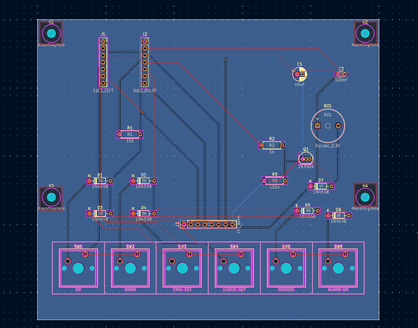
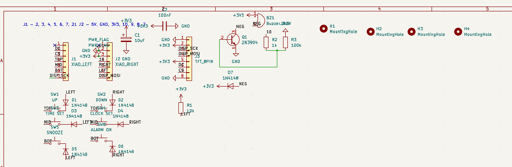
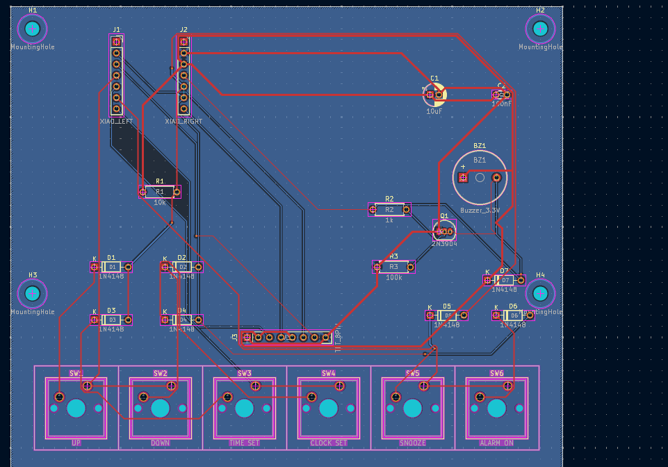
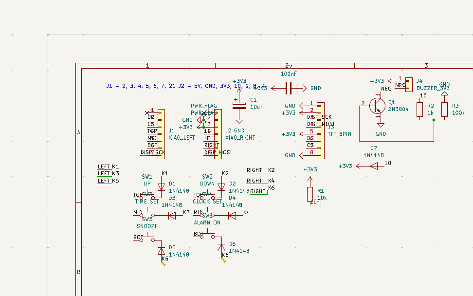
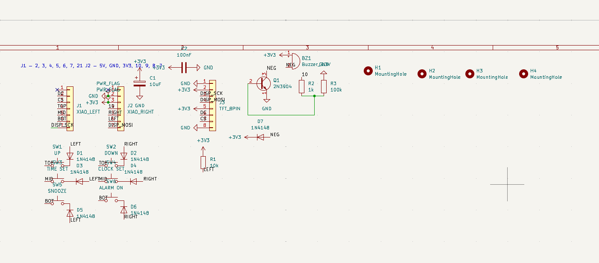
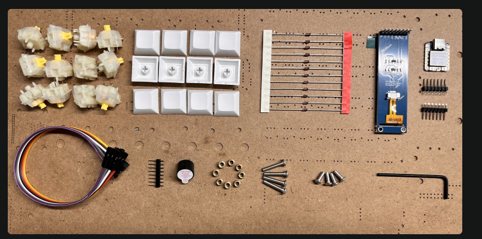
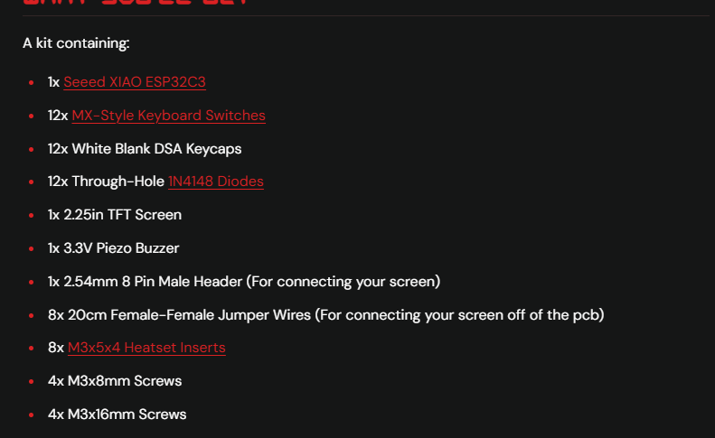
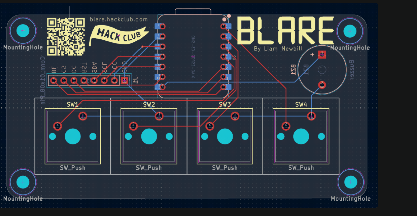

# JJK Alarm

*A Jujutsu Kaisen-inspired alarm clock made for [Hack Club BLARE](https://blare.hackclub.com/), by Vivaan Goel.*

## What I made and why

JJK Alarm is an alarm clock to help me wake up in the morning, with a screen that shows the time and looks cool. My old alarm clock was really old, looked outdated, and had partly broken. I wanted a replacement that actually matched what I liked instead of another plain alarm clock.

My main inspiration was **Ryomen Sukuna's Malevolent Shrine** from *Jujutsu Kaisen*. It is his Domain Expansion, which I think looks really cool. I wanted to turn that shrine style into something I could actually use every day.

### My overall design

This is my actual CAD screenshot, not a photo of a finished physical clock.

## PCB and schematic

I kept the XIAO ESP32-C3 toward the top of the PCB so it would be easier to reach for power and uploading new code. I put all six switches along the bottom to make them easy to press. The buzzer is off to the side so it does not get in the way of the TFT screen. I also tried to leave the middle of the board open for the display and its wiring.

The current board is a **125 × 110 mm rectangular, two-layer PCB**, with a nominal thickness of **1.6 mm**. The six switches have **19.05 mm center-to-center spacing**. This is the rectangular version, not the older T-shaped version from earlier in the project.

The 3D viewer does not show every part, including the fitted XIAO, TFT, switches, and keycaps. It is a view of the PCB design, not a fully assembled clock.

### How the circuit works

The ESP32 reads the six buttons through a switch matrix. The diodes help keep the button readings separate when more than one button is pressed. The ESP32 then updates the TFT over SPI and handles the clock and alarm settings. The buzzer is controlled through a transistor rather than being powered straight from an ESP32 pin. The resistors help with the transistor drive and boot-pin pull-up, and the capacitors are connected across the 3.3 V supply.

The clock uses USB-C power through the XIAO. It does not have an internal battery.

## CAD and how it fits together

I used **Tinkercad**, a shrine model from **MakerWorld**, and input from friends. I did the case modifications myself. I am not claiming that I modeled the original shrine from scratch.

I added rectangular sections to make room for the electronics, cut out the top, and added openings for the TFT screen, switches, and buzzer sound. I also extended the keycaps so the buttons could reach through the case.

My intended assembly slides in from the top. The case parts fit together using friction, with the buttons fitted through their openings. I checked the fit in CAD. That is a CAD check, not a claim that the physical clock has already been printed, assembled, and tested. I also considered a short USB-C extension so the power connection can reach the outside of the case.

The enclosure screenshot above and the PCB view show the parts used for this layout. The original enclosure and keycap exports are preserved in [CAD](CAD/README.md). The current export and complete-assembly status are recorded there; a screenshot is not a replacement for a complete assembly STEP file.

## Challenges

Making the whole thing was pretty frustrating at times. I had to remake parts of the CAD several times, and I do not think all of those changes were recorded. At one point, I remember the PCB having around 52 errors in DRC.

I worked through the problems by asking AI for explanations, trying fixes myself, and getting ideas from friends. My friend and I worked on the PCB and schematic, and I spent a lot of time arranging components, fixing connections, and getting the design checks to pass. I also did the Tinkercad modifications, cutouts, fit checks, and keycap changes myself.

## Firmware

The firmware is written for the **Seeed XIAO ESP32-C3** using Arduino and the Adafruit GFX/ST7789 libraries. The screen stays vertical at **76 × 284 pixels**. The hand-sign image is at the top, with the hours and minutes stacked underneath it.

The ESP32 can use Wi-Fi to synchronize the time. The image itself is stored in the firmware, so it is not downloaded from the internet every time the screen updates. The main loop checks buttons, updates the display, checks the alarm, and handles the local settings page.

The code includes a clock and date display, selectable alarm weekdays, five-minute snooze, alarm dismissal, a countdown timer, a stopwatch, themes, and a local phone settings page. These are implemented software features, not a claim that every feature has been tested on the assembled device.

| Button | What it does |
| --- | --- |
| UP | Increase a value or move through choices |
| DOWN | Decrease a value; hold on the home screen for the stopwatch |
| TIME SET | Set the time and date; hold for the status screen |
| CLOCK SET | Set the alarm and weekdays; hold for the countdown timer |
| SNOOZE | Snooze an alarm for five minutes; hold to dismiss it |
| ALARM ON | Toggle the alarm; hold to change the display theme |

The source is in [Firmware/JJK_Alarm](Firmware/JJK_Alarm). Setup and first-power instructions are in [Firmware/README.md](Firmware/README.md).

**The committed first-power configuration keeps the buzzer silent until its wiring and electrical behavior have been checked.** The firmware has compiled for the real ESP32-C3 target, but compilation is not a physical sound test. It also cannot keep an alarm running through a complete power loss, and the current PCB does not provide firmware control of the TFT backlight.

## Parts I used in the design

This is the current design BOM, not a claim that every part has already been bought or soldered. Quantities are for one clock, not the number of spare parts in the BLARE kit.

| Part | Quantity | What I use it for |
| --- | ---: | --- |
| Custom rectangular PCB, 125 × 110 × 1.6 mm | 1 | Holds and connects the electronics |
| Seeed Studio XIAO ESP32-C3 | 1 | Runs the clock and display |
| 1×7, 2.54 mm female socket strips | 2 | J1 and J2, for mounting the XIAO |
| Compatible 1×7 male header strips | 2 | Fit the XIAO into the sockets |
| 2.25-inch ST7789 TFT, 76 × 284 pixels | 1 | Displays the image, time, and menus |
| 1×8, 2.54 mm male header | 1 | J3, the display connection |
| Female-to-female jumper wires | 8 | Connect the TFT to J3 |
| MX-compatible mechanical switches | 6 | The six buttons |
| Compatible keycaps / printed cap extensions | 6 positions | Make the buttons accessible through the case |
| 1N4148 through-hole diodes | 6 | D1-D6, for the button matrix |
| 1N4148 diode provision | 1 optional | D7; only fit if appropriate for the verified buzzer |
| 3.3 V buzzer | 1 | BZ1, for alarm tones; not a speech/music speaker |
| 2N3904 NPN transistor | 1 | Q1, switches the buzzer |
| 10 kΩ resistor | 1 | R1, GPIO8 pull-up |
| 1 kΩ resistor | 1 | R2, transistor base current limiting |
| 100 kΩ resistor | 1 | R3, transistor base pull-down |
| 10 µF electrolytic capacitor | 1 | C1, power filtering |
| 100 nF ceramic capacitor | 1 | C2, power filtering |
| Printed enclosure and keycap parts | 1 set | Shrine-style case and controls |
| M3 hardware / nonconductive supports | As needed | Four PCB mounting-hole positions; final hardware depends on the case fit |
| Suitable 5 V USB adapter and USB-C cable | 1 set | External power |
| Short USB-C panel-mount extension | 1 planned | Bring the XIAO connection to the case wall |

The socket strips, transistor, resistors, capacitors, power supply, and USB extension should not be assumed to be included in the basic BLARE kit. Exact supplier SKUs and a priced shopping list are not finalized here. The buzzer PCB footprint is `Buzzer_Beeper:Buzzer_12x9.5RM7.6`; that describes the designed package, not a measurement of a received part.

## AI assistance

Just giving you a heads up, AI was used in this project. AI was used in order to add everything and document everything to GitHub, and it is completely AI-assisted. I did the hands-on work, like making the PCB and schematics. However, AI helped me design it by giving me some ideas on how to make it, and mainly my friend and I worked on the PCB and schematics themselves.

The CAD work was my own work, using some models from MakerWorld, because modeling the whole shrine from scratch was too hard to make. Since I cannot code, I worked with AI to make the code through some back and forth. Please accept this, and I understand if you return it. However, this is the best I can do right now. I cannot build a PCB from scratch or write code completely by myself. Thank you so much in advance.

The story in this README comes from my voice-typed explanation. AI helped organize it, format the document, and check the technical descriptions. The screenshots are the ones I supplied from my work. The imported MakerWorld models and supplied artwork are not being claimed as original creations by me.

## Note about Stardance recordings

By the way, I forgot to click **Publish to Stardance** when recording the timelapses of the PCB and schematic. I clicked **Public**, though, so I am not sure whether they will be attached. So sorry about that! Thank you!

## What I would improve next

I might improve the case and simplify some of it into rectangular parts so it is easier to put together. I would also like a bigger TFT screen because this one feels a little underwhelming. Another upgrade would be an actual speaker and audio playback hardware so it could play voices, intros, or other audio instead of just buzzer tones. Those are future upgrades, not features of the current PCB.

## Files and checks

| Folder | Contents |
| --- | --- |
| [CAD](CAD/README.md) | My supplied enclosure/keycap exports and their export-status notes |
| [PCB](PCB/) | Matching `.kicad_pro`, `.kicad_sch`, and `.kicad_pcb` source files |
| [Firmware](Firmware/README.md) | Arduino sketch, image data, configuration template, and setup notes |
| [Production](Production/) | `gerbers.zip`, native check reports, and case-output status |
| [Docs/Images](Docs/Images/) | My original screenshots and artwork, plus an original-byte checksum manifest |
| [Docs/SUBMISSION_CHECK.md](Docs/SUBMISSION_CHECK.md) | Exact remaining submission items and validation evidence |
| [Archive](Archive/) | Superseded T-shaped-board documentation and incomplete exports, not current fabrication files |

Native KiCad reports record **0 ERC errors, 0 ERC warnings, 0 DRC violations, and 0 unconnected pads** under the saved check configuration. The firmware has also passed the ESP32-C3 compilation and host-side alarm/timer tests. Physical assembly, alarm loudness, and long-term operation are separate tests, not things those reports prove.

**Submission note:** I have checked the CAD fit myself, but the uploaded file exports still need to meet the complete-assembly STEP requirement. The board is larger than the under-100 mm guidance in BLARE's PCB tutorial. See the submission checklist for the export issue, size exception, and source-credit details rather than assuming those are already approved.

## Credits

Thanks to Hack Club BLARE for the project and kit, to my friend for working on the PCB and schematic with me, and to the friends who gave me suggestions. The shrine is based on a model from MakerWorld. The exact model URL, creator, and license still need to be recorded in [the attribution notes](Docs/ATTRIBUTION.md).

More of my supplied screenshots and the references I used

### Earlier PCB screenshot

### Earlier schematic screenshot

### PCB while I was working on it

### Schematic while I was fixing errors

### Second copy of the final schematic upload

### Hack Club reference images
These next three images are references from Hack Club that I supplied during the build. They are not photos of my assembled clock or my own example PCB.

