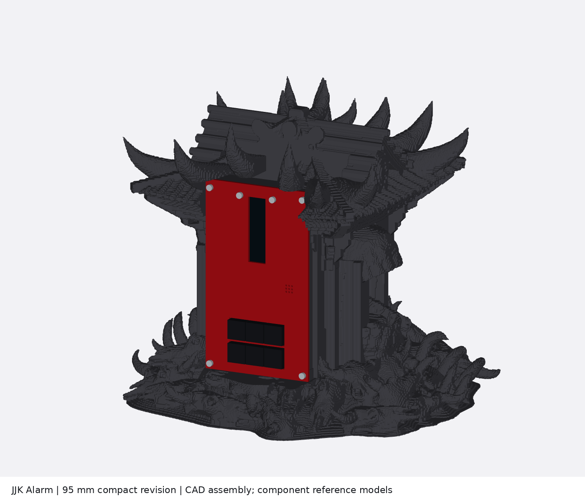
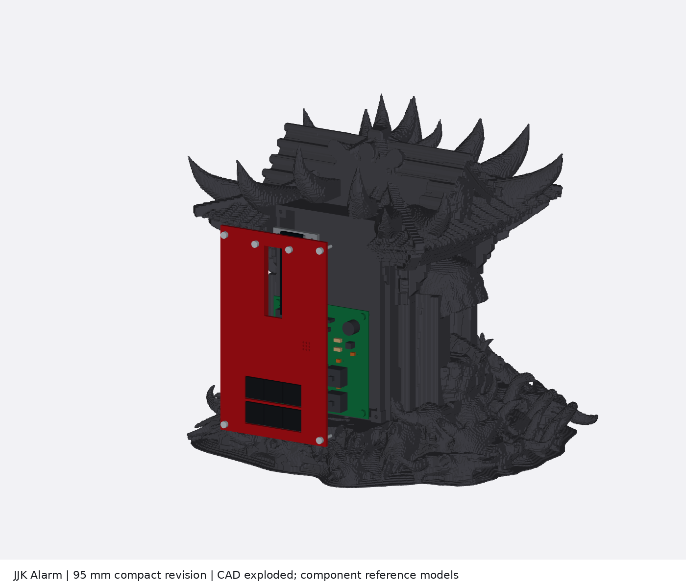
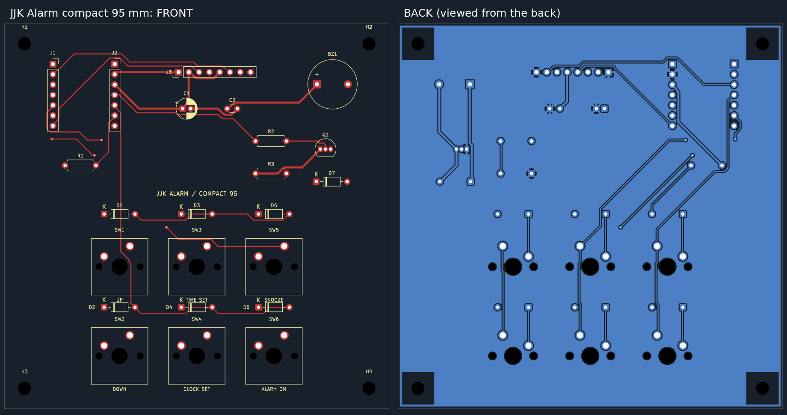
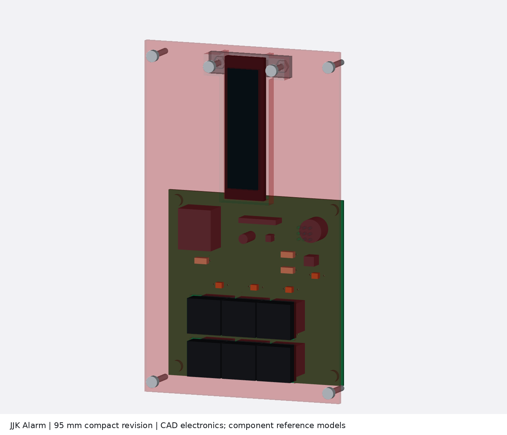
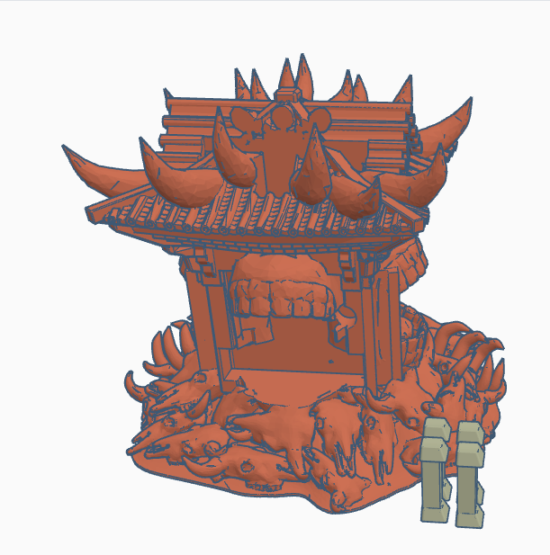
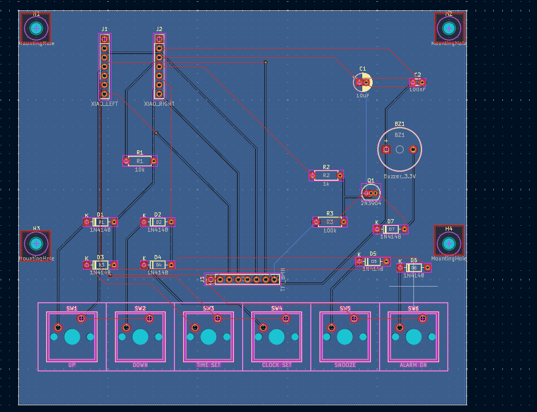
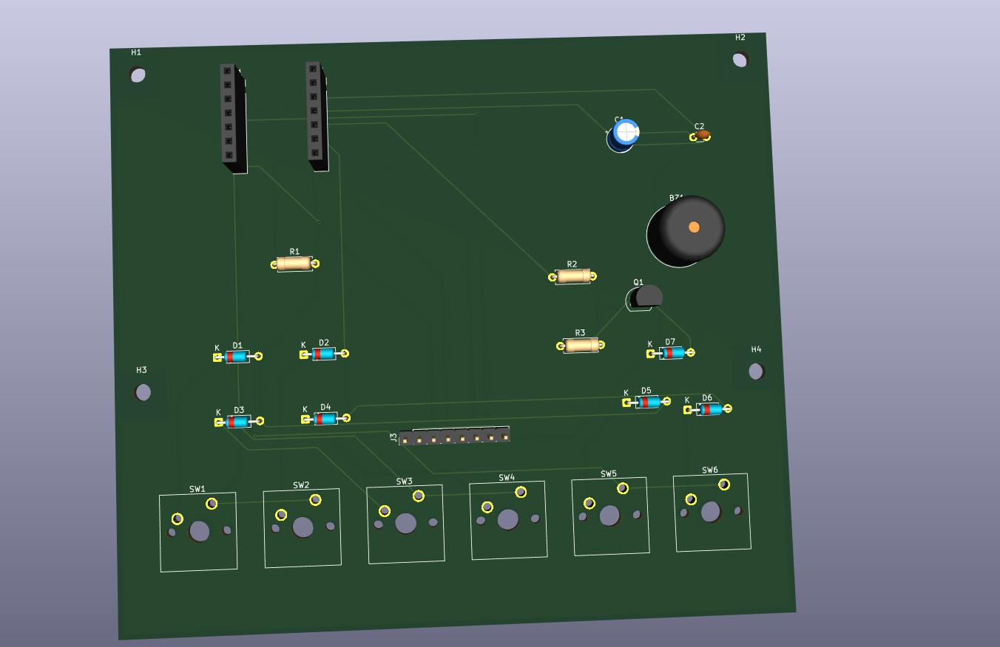
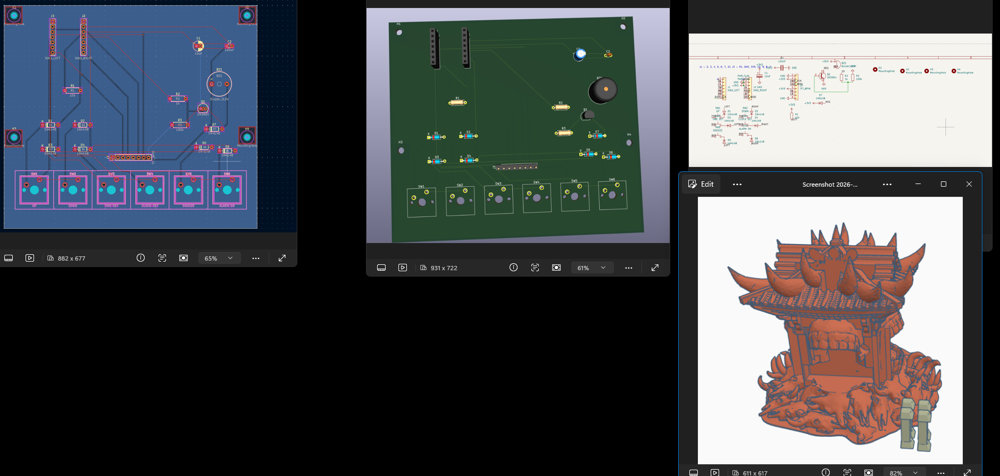

# JJK Alarm

*A Jujutsu Kaisen-inspired alarm clock made for Hack Club BLARE, by Vivaan Goel.*

## What I made and why

My old alarm clock was really old, looked outdated, and had partly broken. I wanted to replace it with something that actually matched what I liked instead of another plain alarm clock. I looked around online, but I could not find one that looked the way I wanted, so I decided to make my own.

My main inspiration was **Sukuna's Malevolent Shrine** from *Jujutsu Kaisen*. I think it is one of the coolest abilities in the series, and I wanted to turn that shrine style into something I could use every day. The screen shows a hand-sign image with the time underneath it.

## Why there are two PCB versions

The original PCB was too big, so I changed the layout later with AI's help and made this smaller **95 × 95 mm** version. I moved the six buttons into two rows of three, but it still does the same things overall. I kept the original PCB and CAD files too, so you can see what changed.

I also changed the PCB a bit later but forgot to update some of the earlier screenshots. The intended function is the same overall, though. The files in **`PCB/`, `CAD/`, `Firmware/`, and `Production/` are the current compact revision**. The older **125 × 110 mm** version is preserved in [Archive/Original_125x110](Archive/Original_125x110/README.md). The old images are history, not the manufacturing reference.

## The current clock

This is a render of the actual revised CAD geometry, not a photo of a built clock. The electronics are labelled dimensional reference models, not manufacturer-certified component CAD.

## PCB and schematic

The board has two copper layers, a **95 × 95 mm** outline, and **1.6 mm nominal finished thickness**. Nothing was uniformly shrunk. The switches, sockets, pin spacing and drill sizes remain full size. The components were moved and the tracks were routed again.

The XIAO ESP32-C3 reads the six buttons through a three-column, two-row matrix. Each switch has a diode. It updates the TFT over SPI and switches the buzzer through Q1, a 2N3904 transistor. R1 pulls GPIO8 high, R2 limits transistor base current, R3 keeps the buzzer driver off at startup, and the capacitors filter the 3.3 V rail.

The compact board uses the **same component-to-net connections and GPIO assignments** as the original rectangular circuit. Native KiCad ERC, DRC, schematic/PCB matching, and unconnected-pad checks pass under the saved check settings. See [the reports](Production/Checks/).

### Button layout, looking at the front

| Left | Middle | Right |
| --- | --- | --- |
| UP (SW1) | TIME SET (SW3) | SNOOZE (SW5) |
| DOWN (SW2) | CLOCK SET (SW4) | ALARM ON (SW6) |

Horizontal switch pitch is **19.05 mm**. The two rows are **22 mm** apart. The compact version uses six normal kit keycaps. My earlier tall printed cap extensions are preserved with the original version, but are not used on this one.

## CAD and assembly

I did my original case work in **Tinkercad**, using a shrine model from **MakerWorld**, my own changes, and ideas from friends. I am not claiming I modeled the original shrine from scratch. Later, AI helped repair the exported geometry and add a new electronics mount and removable front panel for the smaller PCB.

The current complete model is [CAD/JJK_Alarm_Assembly.step](CAD/JJK_Alarm_Assembly.step). It includes the shrine body and integrated carrier, removable front panel, display retainer, drilled PCB, component reference models and fastener references, all placed together. It reopened as **50 valid solids**. The sculptural part is a faceted solid, not a reconstructed editable Tinkercad history.

The separate print files are in [Production/Case_Parts](Production/Case_Parts/). There are **three case parts**: the shrine body with its integrated electronics carrier, the front panel, and the display retainer. Do not print the reference electronics or the old tall keycaps for this revision.

The PCB screws into four supports. The display sits in a pocket behind the front panel and has a removable retaining bar. The back has a USB-cable passage and a zip-tie saddle for strain relief. The front has holes for the buzzer sound. This version does not depend on an unspecified USB-C panel-mount extension.

The decorative shrine remains approximately **339 × 339 × 287 mm**, so it needs a sufficiently large printer or a separately planned print split. Making the PCB smaller did not automatically make the shrine smaller. The decorative skin was remeshed on a 1 mm grid to remove touching/nonmanifold surfaces, which slightly softens fine details. The precise mounting features were added afterward. The untouched owner upload is preserved in [CAD/Owner_Originals](CAD/Owner_Originals/).

The CAD clearance checks use reference dimensions, including a **21.08 × 73.15 × 3.7 mm TFT envelope**. They are not measurements of a received display. Physical assembly, connector fit, tolerances and alarm loudness still require testing. Detailed dimensions and assembly order are in [CAD/README.md](CAD/README.md).

## Firmware

The code is in [Firmware/JJK_Alarm](Firmware/JJK_Alarm/), for the **Seeed XIAO ESP32-C3** using Arduino and Adafruit GFX/ST7789. The portrait screen is **76 × 284 pixels**. The image is stored in the firmware and appears above the stacked hours and minutes.

The code includes Wi-Fi time synchronization, manual clock/date setting, selectable alarm weekdays, five-minute snooze, dismissal, a countdown timer, stopwatch, themes, and a local phone settings page. These are implemented features, not a claim that the assembled clock has been hardware-tested.

| Button | Function |
| --- | --- |
| UP | Increase a value or move through choices |
| DOWN | Decrease a value; hold at home for the stopwatch |
| TIME SET | Edit the clock/date; hold for status |
| CLOCK SET | Edit the alarm and weekdays; hold for the countdown |
| SNOOZE | Snooze for five minutes; hold to dismiss |
| ALARM ON | Toggle the alarm; hold to change the theme |

The current firmware compiles for ESP32-C3 and passes the host-side alarm/timer tests. **The committed first-power configuration keeps the buzzer silent until its wiring and electrical behavior have been checked.** Do not mistake a successful compile for a sound test.

Power is through the XIAO's USB-C connector. There is no internal battery or backup RTC, so a total power loss stops the clock. The PCB also keeps the TFT backlight on rather than switching it in firmware. Setup and first-power instructions are in [Firmware/README.md](Firmware/README.md).

## What still needs checking before I call it finished

The digital files are checked, but I have not printed and assembled this compact version yet. The shrine STL is still **339 × 339 × 287 mm**, so I need a printer that fits it or a proper split design before printing it on a smaller machine.

I also still need to check the actual display, buzzer, sockets, USB plug, screw access, wiring space and full button travel against the case. The display model uses reference dimensions. The saved collision checks cover the PCB/components against the carrier and front panel; they do not prove cable routing, moving-part travel or every interface in the complete assembled clock.

The PCB matrix connections match the firmware: GPIO5/6/7 select the three columns and GPIO8/9 read the two rows. The diode cathodes face the switches. No static matrix mismatch was found, but I still need to test all six buttons, debounce, simultaneous presses and boot/reset behavior on the real board. The alarm/timer tests do not test the physical matrix.

The buzzer stays disabled with the supplied settings. I need to verify its type, current and polarity, Q1 pinout, sound and the display wiring/offsets before enabling it. The clock also needs a supervised alarm/snooze test and a power-loss/restart test. The original shrine and artwork source links/licenses still need completing in the attribution file. So this is a design-review package, and I am **not claiming full submission readiness or a tested working build**.

## Parts for one clock

This BOM describes the compact design. It is not a list of parts already purchased or fitted.

| Part | Quantity | Purpose |
| --- | ---: | --- |
| Custom 95 × 95 mm, two-layer PCB, 1.6 mm finished | 1 | Current compact board |
| Seeed XIAO ESP32-C3 | 1 | Microcontroller and USB-C power |
| 1×7, 2.54 mm female socket strips | 2 | J1/J2 |
| Compatible 1×7 male header strips | 2 | Mount the XIAO in the sockets |
| 2.25-inch ST7789 TFT, 76 × 284 pixels | 1 | Display |
| 1×8, 2.54 mm male header | 1 | J3 |
| Female-to-female jumper wires | 8 | Display wiring |
| MX-compatible switches | 6 | SW1-SW6 |
| Normal compatible 1U DSA keycaps | 6 | The compact version's buttons |
| 1N4148 diodes | 6 | D1-D6 |
| 1N4148 diode | 1 optional | D7, only when appropriate for the actual buzzer |
| 3.3 V buzzer | 1 | BZ1; 12 mm/7.6 mm lead-pitch footprint provision |
| 2N3904 transistor | 1 | Q1 |
| 10 kΩ resistor | 1 | R1 |
| 1 kΩ resistor | 1 | R2 |
| 100 kΩ resistor | 1 | R3 |
| 10 µF electrolytic capacitor | 1 | C1 |
| 100 nF ceramic capacitor | 1 | C2 |
| Printed shrine body, front panel and display retainer | 1 each | Three production case parts |
| M3 × 8 mm screws | 4 | PCB supports |
| M3 × 16 mm screws | 6 | Four front-panel and two display-retainer fasteners |
| M3 hex nuts, nominal 5.5 mm across flats | 10 | Captured fasteners |
| Nonconductive soft shim, about 0.5 mm | 1 | Display retention without hard pressure on glass |
| Nylon zip tie, about 2.5 mm wide | 1 | USB-cable strain relief |
| Reputable 5 V USB adapter and suitable USB-C cable | 1 set | External power |

Some items are extra to the basic kit, including sockets, the transistor/passives, nuts, two additional M3 × 16 mm screws, the shim and power accessories. Exact purchased-part dimensions and prices are not being claimed. The buzzer footprint describes the design, not a measurement of the shipped buzzer.

## Challenges and AI assistance

I spent a lot of time making the PCB and schematic with my friend, arranging parts, fixing errors, and changing the CAD. It got pretty frustrating at times, but I wanted to get it working rather than stop halfway through.

Just giving you a heads up, **AI was used in this project**. My friend and I did the hands-on work on the original PCB and schematic, and AI helped explain things and give me ideas. I did the original Tinkercad modifications using some MakerWorld models because modeling the whole shrine myself was too hard.

Since I cannot code by myself yet, I worked with AI to make the firmware through some back and forth. AI also helped document and upload the project to GitHub, rearrange and route the smaller PCB, repair the exports, and create the new compact mounting parts. I am not claiming those later changes were all hand-designed by me.

The story in this README comes from my voice typing. AI helped organize and format it and check the technical descriptions. I understand if the organizers ask for changes or return it. This is the best I can do right now, and I have learned a lot from working through it. Thank you so much in advance.

## Stardance recording note

By the way, I forgot to click **Publish to Stardance** when recording the timelapses of the PCB and schematic. I clicked **Public**, though, so I am not sure whether they will be attached. So sorry about that! Thank you!

## Project files

| Folder | Contents |
| --- | --- |
| [CAD](CAD/README.md) | Complete placed assembly STEP, checks, reference geometry and original source |
| [PCB](PCB/) | Current matching KiCad project, schematic and compact PCB |
| [Firmware](Firmware/README.md) | Arduino source, artwork and setup instructions |
| [Production](Production/README.md) | Current `gerbers.zip`, drill reports and three case-part exports |
| [Docs](Docs/SUBMISSION_CHECK.md) | Submission inventory, images and test evidence |
| [Archive/Original_125x110](Archive/Original_125x110/README.md) | Preserved original rectangular design, CAD and manufacturing files |

Use the current folders together. Do not mix the original Gerbers, compact PCB and old case openings. The submission files are prepared for technical review; successful file checks do not prove physical safety or guarantee Hack Club acceptance.

## Credits and future ideas

Thanks to Hack Club BLARE for the project and kit, to my friend for working on the PCB and schematic with me, and to the friends who gave me suggestions. The shrine uses a MakerWorld model and the screen uses artwork I supplied. The exact original model/artist links and license details have not yet been established, so I have not invented a creator credit. See [Docs/ATTRIBUTION.md](Docs/ATTRIBUTION.md).

Later, I would like to try a bigger screen and real audio playback hardware. The current buzzer is for tones, not voices or music.

My original screenshots before the compact revision

These remain unmodified history images. The current compact PCB and CAD are shown above.

